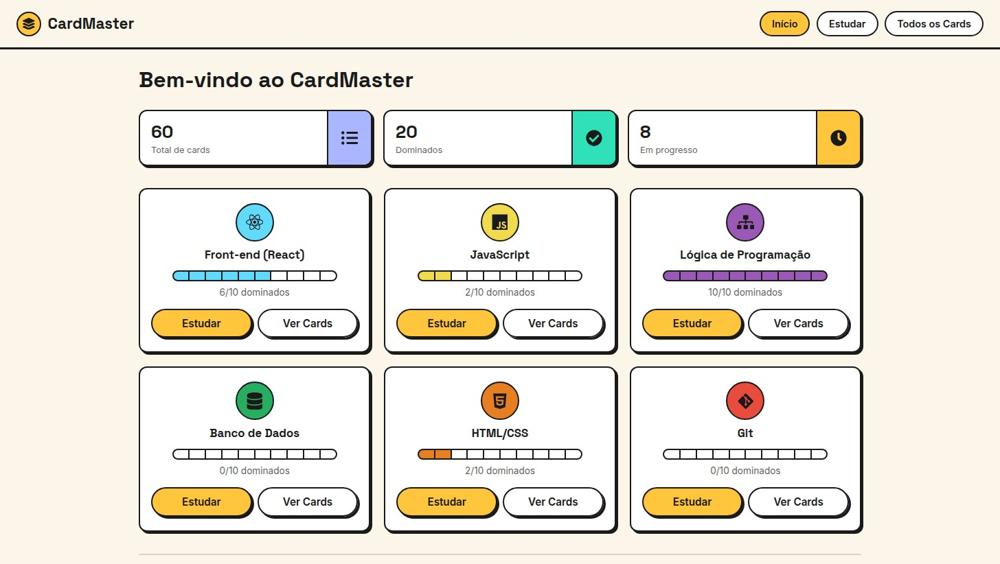
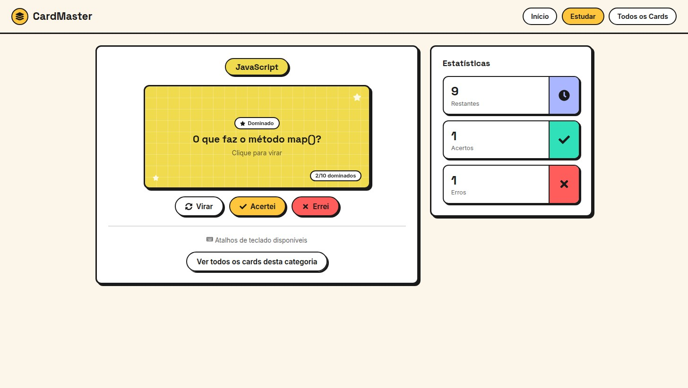
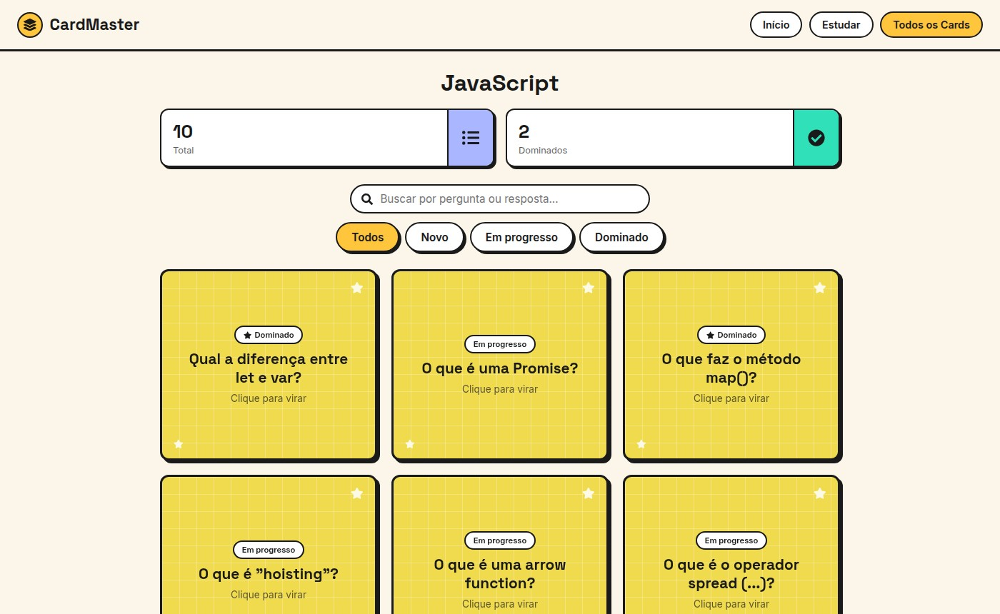

# CardMaster

Front-end de uma aplicação de flashcards para estudo, desenvolvida em React como MVP da disciplina de Desenvolvimento Front-end Avançado (PUC-Rio). A aplicação não possui backend: todos os dados de categorias e cards são lidos de um arquivo JSON local, simulando uma requisição a um servidor.

Este README segue as etapas de desenvolvimento do MVP: o problema, a **ideia**, a **estrutura**, o **protótipo** e o ciclo de **medir e aprender**. A seção [Requisitos do MVP](#requisitos-do-mvp), no final, indica onde cada critério de avaliação está atendido no código.

## Problema e necessidade

Quem estuda tecnologia precisa fixar muitos conceitos ao mesmo tempo: sintaxe, comandos, definições e boas práticas de áreas diferentes. Reler anotações e slides é cansativo e dá uma falsa sensação de domínio, porque reconhecer um texto conhecido é bem mais fácil do que lembrar do conteúdo sem consulta. Além disso, falta uma forma simples de saber o que já foi aprendido e o que ainda precisa de revisão.

### Público-alvo

Estudantes de programação, em especial alunos de cursos técnicos, graduação e pós-graduação em tecnologia, que precisam revisar conceitos de várias disciplinas em pouco tempo.

### Por que flashcards

O flashcard obriga a pessoa a tentar lembrar a resposta antes de vê-la (recuperação ativa), o que fixa melhor o conteúdo do que a releitura. O CardMaster soma a isso uma fila de revisão: o card marcado como errado volta para o fim da sessão e só sai dela quando for acertado, e o status de cada card fica salvo entre as sessões. Assim, o tempo de estudo se concentra no que ainda não foi dominado.

## Ideia

**Funcionalidade principal:** estudar por categoria com flashcards que a pessoa vira para conferir a resposta e marca como "Acertei" ou "Errei", numa fila que repete o que foi errado até ser acertado.

Funcionalidades complementares:

- **Home (Dashboard):** categorias de estudo disponíveis, com o progresso de cada uma ("3/10 dominados"), e estatísticas gerais (total de cards, dominados e em progresso).
- **Study Mode:** a sessão de estudo, com placar de acertos, erros e cards restantes, e uma tela de conclusão ao final.
- **All Cards:** todos os cards de uma categoria, com busca por texto (pergunta ou resposta) combinada com filtro por status (Novo, Em progresso, Dominado).
- **Atalhos de teclado no Study Mode:** Espaço ou Enter vira o card, seta direita (ou `1`) marca acerto, seta esquerda (ou `2`) marca erro.
- **Reiniciar progresso:** botão na Home que apaga o progresso salvo, com confirmação antes de apagar.
- **Página 404:** mensagem amigável para rotas inexistentes, com atalho de volta para a Home.

## Estrutura

### Ferramentas

| Ferramenta | Para que serve no projeto |
|---|---|
| [React](https://react.dev/) 19 | Interface dividida em componentes reutilizáveis, com estado e efeitos controlados por hooks (`useState`, `useEffect`, `useMemo`, `useCallback`, `useContext`). |
| [Vite](https://vitejs.dev/) | Servidor de desenvolvimento com atualização instantânea e build de produção otimizado, sem configuração extra. |
| [React Router](https://reactrouter.com/) (`react-router-dom`) | Rotas com parâmetro (`/study/:categoryId`, `/cards/:categoryId`), layout compartilhado entre as páginas via `<Outlet />` e rota coringa (`*`) para a página 404. |
| [styled-components](https://styled-components.com/) | Estilo escrito junto do componente, sem conflito de nomes de classe, e variando por props (por exemplo, a cor da categoria no card e as variantes do botão). |
| [react-icons](https://react-icons.github.io/react-icons/) | Ícones como componentes React; o JSON indica o nome do ícone de cada categoria. |
| JSON local (`public/data/flashcards.json`) | Simula a API: é carregado com `fetch` e um atraso artificial, com estados de carregamento e erro, para que a aplicação já esteja preparada para receber um backend real. |
| `localStorage` | Guarda o status de cada card no próprio navegador, mantendo o progresso entre as sessões sem precisar de servidor. |
| [ESLint](https://eslint.org/) | Análise estática, incluindo as regras de uso correto dos hooks do React. |

### Organização do código

```
src/
├── components/   componentes reutilizáveis (um diretório por componente, com .jsx e .styles.js)
├── context/      FlashcardsContext: disponibiliza os dados e as ações para toda a aplicação
├── hooks/        useFlashcardsData (carregamento, progresso, estatísticas) e useLocalStorage
├── layout/       MainLayout: cabeçalho compartilhado e área onde cada página é renderizada
├── pages/        Home, StudyMode, AllCards e NotFound
├── router/       definição das rotas
└── styles/       tokens de design (cores, fontes, raios de borda e sombras) e estilos globais
```

Os dados seguem um caminho único: o hook `useFlashcardsData` carrega o JSON e junta cada card com o status salvo no `localStorage`; o `FlashcardsContext` entrega esse resultado às páginas, que leem os dados e chamam as ações (`markCorrect`, `markWrong`, `resetProgress`) sem passar props por vários níveis.

### Componentes reutilizáveis

- `ActionButton`: botão padronizado com variantes de estilo (primário, secundário, perigo e discreto) e ícone opcional, usado em todas as páginas.
- `StatCard`: bloco de estatística com título, valor, cor, ícone e dica configuráveis via props.
- `CategoryCard`: card de categoria com ícone, progresso e atalhos para estudar ou ver os cards.
- `ConfirmModal`: modal de confirmação para ações que não podem ser desfeitas.
- `EmptyState`: mensagem para listas vazias ou buscas sem resultado.
- `ErrorState`: mensagem de erro de carregamento com o botão "Tentar novamente", usada nas três páginas que dependem dos dados.
- `LoadingSpinner`: indicador animado com mensagem, exibido enquanto os dados carregam nas três páginas que dependem deles.
- `InteractiveFlashcard`: card de pergunta e resposta que vira ao clicar; reutilizado em modo interativo (Study Mode) e em modo somente leitura (All Cards).
- `NavigationHeader`: cabeçalho com logo e navegação, com o link ativo destacado via `useLocation`.
- `Tooltip`: dica exibida ao passar o mouse ou focar o elemento pelo teclado.

## Protótipo

O protótipo é a própria aplicação, que roda localmente seguindo os passos abaixo.

### Telas e rotas

| Rota | Tela |
|---|---|
| `/` | Home (Dashboard) |
| `/study/:categoryId` | Study Mode da categoria |
| `/cards/:categoryId` | All Cards da categoria |
| qualquer outra | Página 404 |

### Capturas de tela

**Home (Dashboard):** estatísticas gerais e o progresso de cada categoria.



**Study Mode:** sessão em andamento, com o placar de cards restantes, acertos e erros.



**All Cards:** busca, filtro por status e um card virado mostrando a resposta.



### Pré-requisitos

- [Node.js](https://nodejs.org/) versão 20.19 ou superior (ou 22.12 ou superior), exigida pelo Vite 8
- npm (instalado junto com o Node.js)

### Instalação e execução local

1. Clone o repositório:
   ```bash
   git clone https://github.com/Cleok3Lima/frontend-avancado-mvp.git
   cd frontend-avancado-mvp
   ```
2. Instale as dependências:
   ```bash
   npm install
   ```
3. Inicie o servidor de desenvolvimento:
   ```bash
   npm run dev
   ```
4. Abra o endereço exibido no terminal (por padrão, [http://localhost:5173](http://localhost:5173)) no navegador.

### Build de produção

```bash
npm run build
npm run preview
```

O comando `build` gera os arquivos otimizados na pasta `dist/`; `preview` serve esse build localmente para validação.

## Medir e aprender

O MVP fecha o ciclo construir, medir e aprender: a própria aplicação registra dados sobre o estudo, e esses dados apontam o que melhorar.

### O que a aplicação mede

- **Por card:** o status de cada um (Novo, Em progresso ou Dominado), salvo entre as sessões.
- **Por categoria:** quantos cards já foram dominados em relação ao total.
- **No geral:** total de cards, quantos foram dominados e quantos estão em progresso (já errados ao menos uma vez).
- **Por sessão:** acertos, erros e cards restantes, com o resumo exibido ao concluir.

### Próximos passos

O que os dados acima mostram sobre os limites desta versão, e o que viria nas próximas:

- **Repetição espaçada por data:** hoje um único acerto marca o card como dominado. A próxima versão agendaria revisões em intervalos crescentes (1 dia, 3 dias, 1 semana), para confirmar que o conteúdo foi realmente fixado.
- **Histórico de sessões:** guardar o placar de cada sessão para mostrar a evolução ao longo do tempo, e não só o estado atual.
- **Cards próprios:** permitir criar, editar e excluir cards e categorias, para que cada pessoa estude o próprio conteúdo.
- **Backend e contas de usuário:** substituir o JSON local por uma API e o `localStorage` por um banco de dados, para sincronizar o progresso entre dispositivos. Como o carregamento já é feito via `fetch`, a troca fica concentrada no hook `useFlashcardsData`.

## Requisitos do MVP

Onde cada critério da avaliação está atendido no código.

### Componentização

- **Três páginas componentizadas:** [`Home`](src/pages/Home/Home.jsx), [`StudyMode`](src/pages/StudyMode/StudyMode.jsx) e [`AllCards`](src/pages/AllCards/AllCards.jsx), além da [`NotFound`](src/pages/NotFound/NotFound.jsx).
- **Componentes reutilizados entre páginas:**

| Componente | Usado em |
|---|---|
| [`ActionButton`](src/components/ActionButton/ActionButton.jsx) | Home, Study Mode, All Cards e 404 (e dentro de `CategoryCard`, `ConfirmModal`, `ErrorState` e `InteractiveFlashcard`) |
| [`StatCard`](src/components/StatCard/StatCard.jsx) | Home, Study Mode e All Cards |
| [`LoadingSpinner`](src/components/LoadingSpinner/LoadingSpinner.jsx) | Home, Study Mode e All Cards |
| [`ErrorState`](src/components/ErrorState/ErrorState.jsx) | Home, Study Mode e All Cards |
| [`EmptyState`](src/components/EmptyState/EmptyState.jsx) | Study Mode e All Cards |
| [`InteractiveFlashcard`](src/components/InteractiveFlashcard/InteractiveFlashcard.jsx) | Study Mode (interativo) e All Cards (somente leitura) |
| [`Tooltip`](src/components/Tooltip/Tooltip.jsx) | Home, Study Mode e dentro de `StatCard` |

- **Elementos originais:** card com virada em 3D, fila de revisão que devolve o card errado para o fim da sessão, atalhos de teclado no Study Mode, barra de progresso por categoria no formato de células e progresso salvo no `localStorage`.
- **Requisição simulada:** [`useFlashcardsData`](src/hooks/useFlashcardsData.js) lê `public/data/flashcards.json` com `fetch` e um atraso artificial de 600 ms, passando pelos estados de carregamento, erro e sucesso.

### React e roteamento

- **Estados, props e hooks:** `useState` e `useEffect` nas páginas e componentes; `useMemo` e `useCallback` em `useFlashcardsData`; `useContext` em [`FlashcardsContext`](src/context/FlashcardsContext.jsx); `useRef` e `useLayoutEffect` em `Home` e `Tooltip`; hooks próprios `useFlashcardsData` e `useLocalStorage`. As props configuram os componentes reutilizáveis, como a variante do `ActionButton` e o título, a cor e a dica do `StatCard`.
- **Rotas:** definidas em [`AppRouter`](src/router/AppRouter.jsx), com layout compartilhado ([`MainLayout`](src/layout/MainLayout.jsx) e `<Outlet />`).
- **Hooks de navegação:**

| Hook | Onde | Para quê |
|---|---|---|
| `useNavigate` | `StudyMode`, `AllCards`, `NotFound` e `CategoryCard` | Ir para o Study Mode ou para All Cards de uma categoria e voltar para a Home |
| `useParams` | `StudyMode` e `AllCards` | Ler o `:categoryId` da URL e carregar os cards da categoria |
| `useLocation` | `NavigationHeader` | Destacar o link ativo e manter a categoria atual nos links "Estudar" e "Todos os Cards" |

- **Rota 404:** a rota coringa `path="*"` exibe a `NotFound`. Uma categoria inexistente, como `/study/xyz`, também exibe a `NotFound`.

### Usabilidade

- **Feedback visual:** mensagem de sucesso depois de reiniciar o progresso, brilho no card ao marcar "Acertei", destaque no filtro de status selecionado e no link ativo do cabeçalho.
- **Tooltips:** no botão "Reiniciar progresso", nos ícones de "Dominados" e "Em progresso" da Home e no aviso de atalhos de teclado do Study Mode.
- **Mensagens condicionais:** "Nenhum card encontrado com esses filtros" na busca do All Cards, "Nenhum card encontrado nesta categoria" para categoria vazia e mensagem de erro com o botão "Tentar novamente" quando os dados não carregam.
- **Indicadores de carregamento, sucesso e erro:** `LoadingSpinner` com mensagem própria em cada página, `ErrorState` e a tela de "Sessão concluída!" com o placar da sessão.
- **Layout adaptável:** as grades da Home e do All Cards se reorganizam conforme a largura (`auto-fit`); o Study Mode usa duas colunas a partir de 1024px e uma coluna abaixo disso; o cabeçalho empilha logo e navegação em telas de até 640px.

### Organização e documentação

- **Estrutura de pastas:** descrita em [Organização do código](#organização-do-código).
- **Nomenclatura:** componentes e páginas em PascalCase, cada um no próprio diretório com `.jsx` e `.styles.js`; hooks com prefixo `use`.
