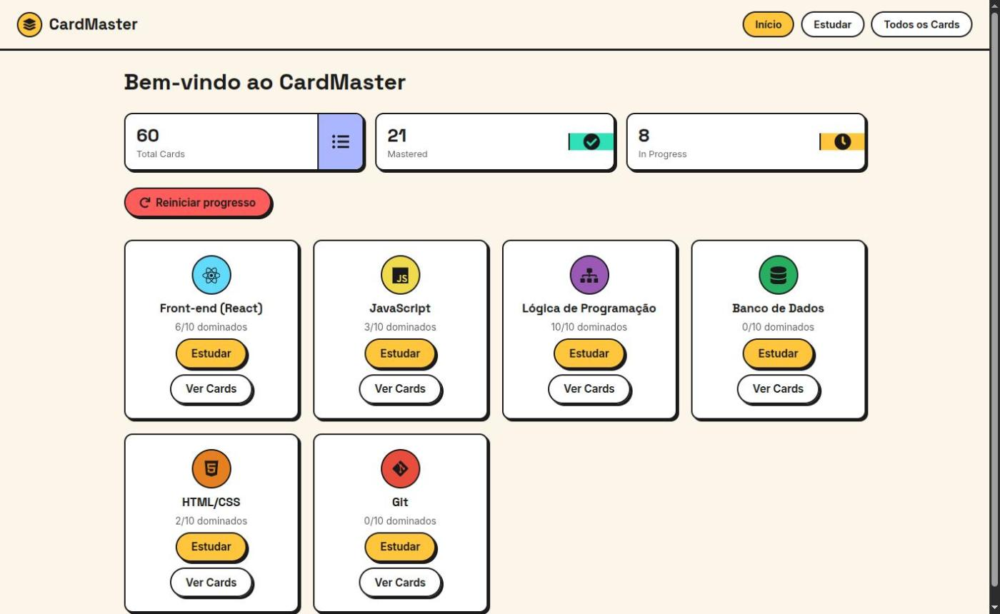
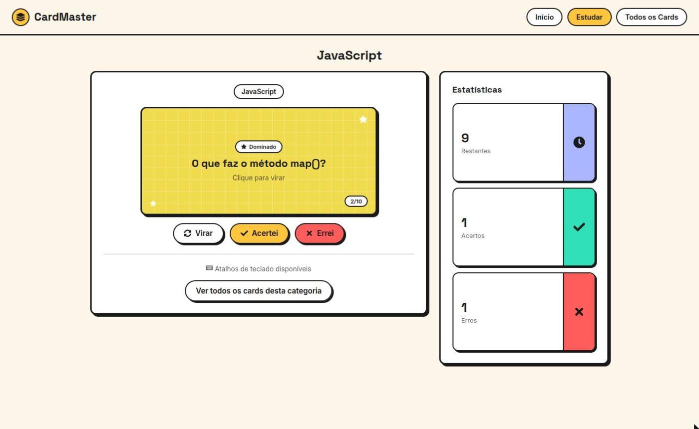
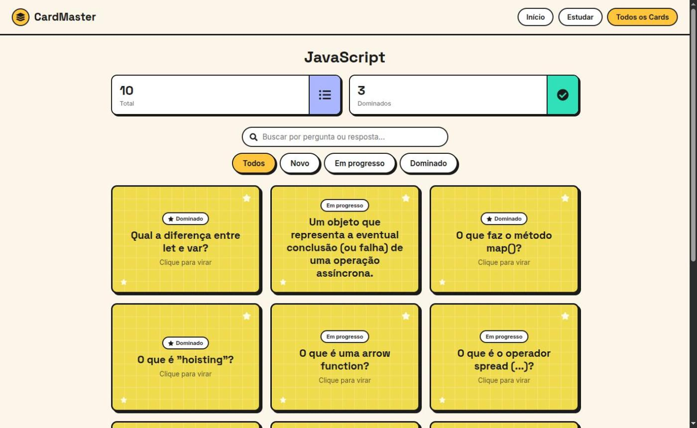

# CardMaster

Front-end de uma aplicação de flashcards para estudo, desenvolvida em React como MVP da disciplina de Desenvolvimento Front-end Avançado (PUC-Rio). A aplicação não possui backend: todos os dados de categorias e cartões são lidos de um arquivo JSON local, simulando uma requisição a um servidor.

Este README segue as etapas de desenvolvimento do MVP: o problema, a **ideia**, a **estrutura**, o **protótipo** e o ciclo de **medir e aprender**.

## Problema e necessidade

Quem estuda tecnologia precisa fixar muitos conceitos ao mesmo tempo: sintaxe, comandos, definições e boas práticas de áreas diferentes. Reler anotações e slides é cansativo e dá uma falsa sensação de domínio, porque reconhecer um texto conhecido é bem mais fácil do que lembrar do conteúdo sem consulta. Além disso, falta uma forma simples de saber o que já foi aprendido e o que ainda precisa de revisão.

### Público-alvo

Estudantes de programação, em especial alunos de cursos técnicos, graduação e pós-graduação em tecnologia, que precisam revisar conceitos de várias disciplinas em pouco tempo.

### Por que flashcards

O flashcard obriga a pessoa a tentar lembrar a resposta antes de vê-la (recuperação ativa), o que fixa melhor o conteúdo do que a releitura. O CardMaster soma a isso uma fila de revisão: o cartão marcado como errado volta para o fim da sessão e só sai dela quando for acertado, e o status de cada cartão fica salvo entre as sessões. Assim, o tempo de estudo se concentra no que ainda não foi dominado.

## Ideia

**Funcionalidade principal:** estudar por categoria com flashcards que a pessoa vira para conferir a resposta e marca como "Acertei" ou "Errei", numa fila que repete o que foi errado até ser acertado.

Funcionalidades complementares:

- **Home (Dashboard):** categorias de estudo disponíveis, com o progresso de cada uma ("3/10 dominados"), e estatísticas gerais (Total Cards, Mastered, In Progress).
- **Study Mode:** a sessão de estudo, com placar de acertos, erros e cartões restantes, e uma tela de conclusão ao final.
- **All Cards:** todos os cartões de uma categoria, com busca por texto (pergunta ou resposta) combinada com filtro por status (Novo, Em progresso, Dominado).
- **Atalhos de teclado no Study Mode:** Espaço ou Enter vira o card, seta direita (ou `1`) marca acerto, seta esquerda (ou `2`) marca erro.
- **Reiniciar progresso:** botão na Home que apaga o progresso salvo, com confirmação antes de apagar.
- **Página 404:** mensagem amigável para rotas inexistentes, com atalho de volta para a Home.

## Estrutura

### Ferramentas

| Ferramenta | Para que serve no projeto |
|---|---|
| [React](https://react.dev/) 19 | Interface dividida em componentes reutilizáveis, com estado e efeitos controlados por hooks (`useState`, `useEffect`, `useMemo`, `useCallback`, `useContext`). |
| [Vite](https://vitejs.dev/) | Servidor de desenvolvimento com atualização instantânea e build de produção otimizado, sem configuração extra. |
| [React Router](https://reactrouter.com/) (`react-router-dom`) | Rotas com parâmetro (`/study/:categoryId`, `/cards/:categoryId`), layout compartilhado entre as páginas via `<Outlet />` e rota coringa (`*`) para a página 404. |
| [styled-components](https://styled-components.com/) | Estilo escrito junto do componente, sem conflito de nomes de classe, e variando por props (por exemplo, a cor da categoria no card e as variantes do botão). |
| [react-icons](https://react-icons.github.io/react-icons/) | Ícones como componentes React; o JSON indica o nome do ícone de cada categoria. |
| JSON local (`public/data/flashcards.json`) | Simula a API: é carregado com `fetch` e um atraso artificial, com estados de carregamento e erro, para que a aplicação já esteja preparada para receber um backend real. |
| `localStorage` | Guarda o status de cada cartão no próprio navegador, mantendo o progresso entre as sessões sem precisar de servidor. |
| [ESLint](https://eslint.org/) | Análise estática, incluindo as regras de uso correto dos hooks do React. |

### Organização do código

```
src/
├── components/   componentes reutilizáveis (um diretório por componente, com .jsx e .styles.js)
├── context/      FlashcardsContext: disponibiliza os dados e as ações para toda a aplicação
├── hooks/        useFlashcardsData (carregamento, progresso, estatísticas) e useLocalStorage
├── layout/       MainLayout: cabeçalho compartilhado e área onde cada página é renderizada
├── pages/        Home, StudyMode, AllCards e NotFound
├── router/       definição das rotas
└── styles/       tokens de design (cores, fontes, raios de borda e sombras) e estilos globais
```

Os dados seguem um caminho único: o hook `useFlashcardsData` carrega o JSON e junta cada cartão com o status salvo no `localStorage`; o `FlashcardsContext` entrega esse resultado às páginas, que leem os dados e chamam as ações (`markCorrect`, `markWrong`, `resetProgress`) sem passar props por vários níveis.

### Componentes reutilizáveis

- `BotaoAcao`: botão padronizado com variantes de estilo (primário, secundário, perigo e discreto) e ícone opcional, usado em todas as páginas.
- `CardEstatistica`: bloco de estatística com título, valor, cor, ícone e dica configuráveis via props.
- `CategoryCard`: card de categoria com ícone, progresso e atalhos para estudar ou ver os cartões.
- `ConfirmModal`: modal de confirmação para ações que não podem ser desfeitas.
- `EmptyState`: mensagem para listas vazias ou buscas sem resultado.
- `FlashcardInterativo`: card de pergunta e resposta que vira ao clicar; reutilizado em modo interativo (Study Mode) e em modo somente leitura (All Cards).
- `HeaderNavegacao`: cabeçalho com logo e navegação, com o link ativo destacado via `useLocation`.
- `Tooltip`: dica exibida ao passar o mouse ou focar o elemento pelo teclado.

## Protótipo

O protótipo é a própria aplicação, que roda localmente seguindo os passos abaixo.

### Telas e rotas

| Rota | Tela |
|---|---|
| `/` | Home (Dashboard) |
| `/study/:categoryId` | Study Mode da categoria |
| `/cards/:categoryId` | All Cards da categoria |
| qualquer outra | Página 404 |

### Capturas de tela

**Home (Dashboard):** estatísticas gerais e o progresso de cada categoria.



**Study Mode:** sessão em andamento, com o placar de cartões restantes, acertos e erros.



**All Cards:** busca, filtro por status e um cartão virado mostrando a resposta.



### Pré-requisitos

- [Node.js](https://nodejs.org/) versão 20.19 ou superior (ou 22.12 ou superior), exigida pelo Vite 8
- npm (instalado junto com o Node.js)

### Instalação e execução local

1. Clone o repositório:
   ```bash
   git clone https://github.com/Cleok3Lima/frontend-avancado-mvp.git
   cd frontend-avancado-mvp
   ```
2. Instale as dependências:
   ```bash
   npm install
   ```
3. Inicie o servidor de desenvolvimento:
   ```bash
   npm run dev
   ```
4. Abra o endereço exibido no terminal (por padrão, [http://localhost:5173](http://localhost:5173)) no navegador.

### Build de produção

```bash
npm run build
npm run preview
```

O comando `build` gera os arquivos otimizados na pasta `dist/`; `preview` serve esse build localmente para validação.

## Medir e aprender

O MVP fecha o ciclo construir, medir e aprender: a própria aplicação registra dados sobre o estudo, e esses dados apontam o que melhorar.

### O que a aplicação mede

- **Por cartão:** o status de cada um (Novo, Em progresso ou Dominado), salvo entre as sessões.
- **Por categoria:** quantos cartões já foram dominados em relação ao total.
- **No geral:** total de cartões, quantos foram dominados e quantos estão em progresso (já errados ao menos uma vez).
- **Por sessão:** acertos, erros e cartões restantes, com o resumo exibido ao concluir.

### Próximos passos

O que os dados acima mostram sobre os limites desta versão, e o que viria nas próximas:

- **Repetição espaçada por data:** hoje um único acerto marca o cartão como dominado. A próxima versão agendaria revisões em intervalos crescentes (1 dia, 3 dias, 1 semana), para confirmar que o conteúdo foi realmente fixado.
- **Histórico de sessões:** guardar o placar de cada sessão para mostrar a evolução ao longo do tempo, e não só o estado atual.
- **Cartões próprios:** permitir criar, editar e excluir cartões e categorias, para que cada pessoa estude o próprio conteúdo.
- **Backend e contas de usuário:** substituir o JSON local por uma API e o `localStorage` por um banco de dados, para sincronizar o progresso entre dispositivos. Como o carregamento já é feito via `fetch`, a troca fica concentrada no hook `useFlashcardsData`.
